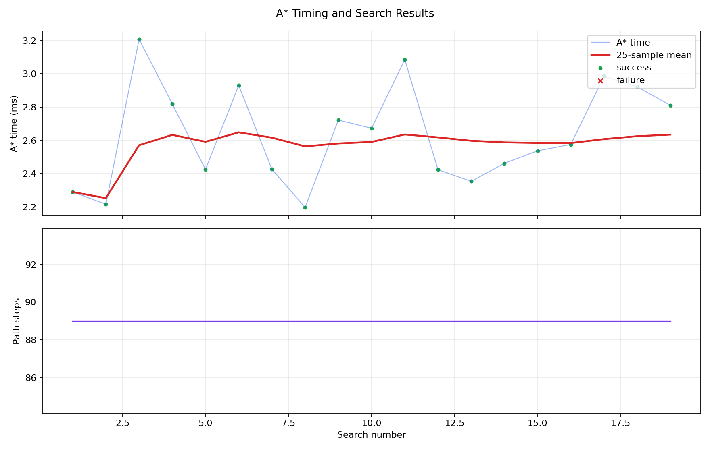

# A* Thoughts for Planning

- Point selection, good, seems to be choosing good routes that avoid the obstacles. Inflation can be tweaked to improve points as needed, so good waypoints.
- Timing - Pretty good (see graph). But A* planning in general is costly especially w/ map updates
- How to do small planning? Won't be able to see whole map (in small area we can see, how to choose start/goal?) Probably would come from lane waypoints of some sort.
- A* point plans, not for a car, (speed, heading, pose, vehicle constraints etc.), however the points are OK in our circumstances, so maybe it would be fine.
- Dynamic obstacles (pedestrians, or just bad obstacle detection -> replanning needed, etc), what can we expect from perception?
- Maybe should work on controls/perception first, then come back to this.

## Example Plan and Timing Graph

